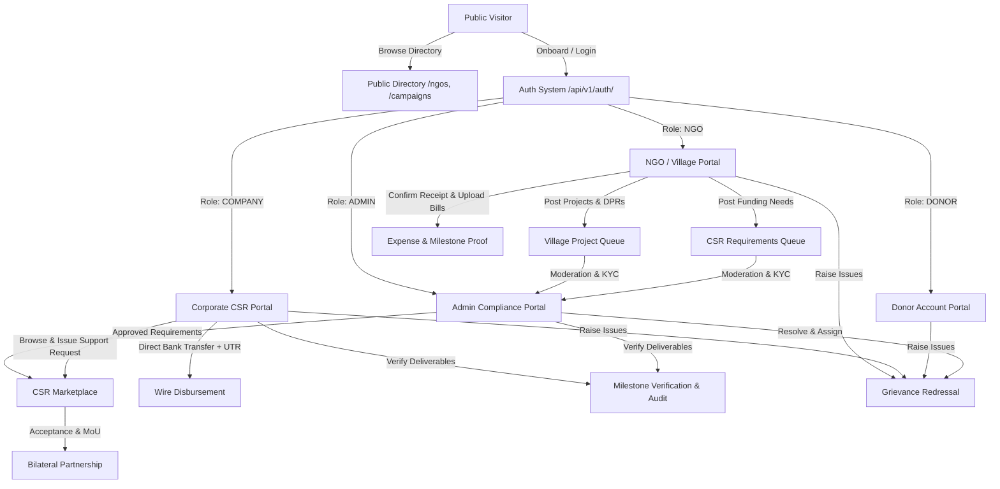
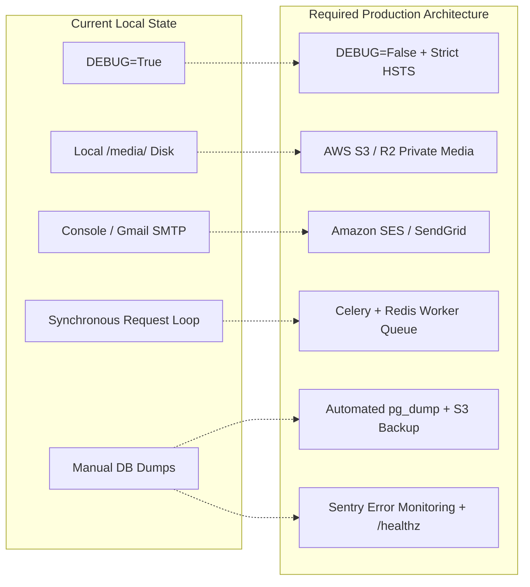
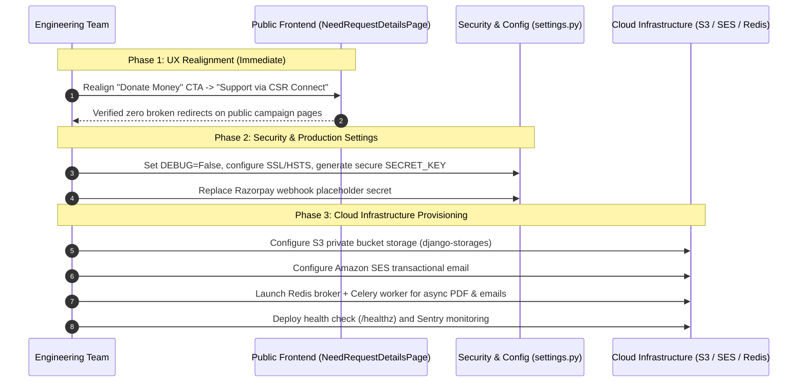

# DaanGives — Consolidated Full-Project Completion and Gap Audit

**Date of Audit:** October 13, 2026  
**Audited Repositories:**  
- **Frontend:** `/Users/chaudharykamlesh/Desktop/daangives-frontend` (Vite, React 19, Vanilla CSS Design System, Vitest)  
- **Backend:** `/Users/chaudharykamlesh/Desktop/daangives-backend` (Django 6.1, Django REST Framework, PostgreSQL / SQLite)  
**Audit Execution Mode:** Strictly READ-ONLY (Safe verification, no record mutations, no schema modifications, no external side-effects)

---

## 1. Executive Summary

DaanGives has evolved from an individual donor crowdfunding concept into **"CSR Connect"** — a comprehensive B2B compliance, matchmaking, and financial transparency platform connecting rural village development projects and verified grassroots NGOs with corporate CSR funding partners under Schedule VII of the Indian Companies Act 2013.

The software implementation demonstrates an exceptionally mature backend domain architecture and an extensive frontend component ecosystem. The platform enforces strict multi-tenant isolation across four primary roles (`DONOR`, `NGO`, `COMPANY`, `ADMIN`), with robust off-platform bank wire disbursement tracking (UTR verification), bilateral MoU countersigning, milestone-based proof submission, and full statutory tax receipting (Section 80G digital hashing, Form 10BD/10BE ledgers).

### Evidence-Based Completion Scores

| Assessment Dimension | Score | Primary Criteria & Verified Evidence |
| :--- | :---: | :--- |
| **Feature Implementation Completeness** | **89%** | All core modules across NGO onboarding (6-step flow), Village Projects (Gram Panchayat NOC/DPRs), CSR Company onboarding (CIN/CSR-1/PAN), Bilateral MoU lifecycle, Direct Wire Disbursements (UTR/evidence), Milestone Verification, Grievance Redressal, and Public Directories are fully coded with corresponding backend views, serializers, and frontend interfaces. Retail donation steps exist in codebase but are intentionally routed away in the frontend. |
| **End-to-End Workflow Completeness** | **83%** | Complete end-to-end traversals for NGO-Admin verification, Project approval, Company onboarding, and Bilateral CSR partnerships are operational. The main workflow gap is the contradiction between the active "Donate Money →" CTA on public campaign pages and the deactivated retail donation routes that bounce visitors to the homepage. |
| **Automated Verification Completeness** | **86%** | **1,199 backend tests passing** with 0 failures (824 across `users`, `csr`, `projects`, `grievances`; 375 across `ngo`, `campaigns`). **168 frontend Vitest tests passing** (42/42 test suites). Clean Vite production build (52 chunks, 0 errors). Gaps: No automated Playwright E2E browser tests in continuous integration due to sandbox execution environment limits. |
| **Production Launch Readiness** | **48%** | Backend currently runs with `DEBUG=True`; `SECRET_KEY` uses dev values; media files reside on local filesystem (`BASE_DIR / 'media'`); email relies on Gmail SMTP / console backend without Celery task queues; no automated database backup pipeline, health monitoring (`/healthz`), or Sentry error capture. |

---

## 2. Current Architecture and Role Workflows

The platform operates on a single RESTful backend API with namespace segregation and a single-page React frontend:



### Role Workflows & Route Matrix

| Role | Primary User Journey | Verified Frontend Routes | Backend API Namespaces |
| :--- | :--- | :--- | :--- |
| **Public Visitor** | Homepage discovery, searching verified NGOs and village campaigns with debounced filters and pagination. | `/`, `/ngos`, `/campaigns`, `/campaigns/:id`, `/csr` | `/api/v1/public/`, `/api/v1/campaigns/`, `/api/v1/projects/public/` |
| **NGO / Village Lead** | 6-step statutory onboarding (12A/80G/FCRA/Bank/Panchayat NOC), project DPR uploads, CSR funding proposals, partnership management, disbursement receipts, expense invoices. | `/ngo/registration-flow`, `/ngo/dashboard`, `/ngo/profile`, `/ngo/projects/*`, `/ngo/csr/*`, `/ngo/tickets/*` | `/api/v1/ngo/`, `/api/v1/projects/`, `/api/v1/ngo/csr/` |
| **Corporate CSR Partner** | Statutory corporate verification (CIN, CSR-1, PAN, Board Resolution), thematic preference setup (SDG/state/budget), marketplace browsing, support request issuance, MoU countersignature, UTR wire logging, milestone audits. | `/company/dashboard`, `/company/profile`, `/company/preferences`, `/company/marketplace`, `/company/partnerships/*`, `/company/tickets/*` | `/api/v1/csr/` |
| **Admin Compliance Officer** | Verification of NGO statutory claims, inspection of Gram Panchayat NOCs and technical estimates, company KYC verification, requirement approval, disbursement reconciliation, grievance ticket management. | `/admin/dashboard`, `/admin/ngos/*`, `/admin/projects/*`, `/admin/csr/*`, `/admin/complaints/*`, `/admin/analytics` | `/api/v1/admin/`, `/api/v1/admin/csr/`, `/api/v1/projects/`, `/api/v1/grievances/` |
| **Individual Donor** | Profile management, ticket submission. (Retail monetary donation workflow currently deactivated). | `/donor/dashboard`, `/donor/profile`, `/donor/tickets/*` | `/api/v1/donations/`, `/api/v1/users/` |

---

## 3. Completed, Partially Completed, Broken and Unverified Features

Each capability is categorized according to the required evaluation taxonomy:
- **Implemented and source-verified**: Code completely written, wired, and structurally sound.
- **Automated-test verified**: Backed by automated unit/integration tests that pass in the test suite.
- **Browser/end-to-end verified**: Verified through browser runtime or manual interactive session.
- **Partially implemented**: Core logic present but certain paths incomplete or lacking integration.
- **Broken or inconsistent**: Conflicting logic, dead redirects, or contradictory behaviors.
- **Not implemented**: Capability absent from codebase.
- **Unable to verify**: Cannot be validated without external production services or sandbox bypass.

### 1. Authentication, Registration, Roles and Protected Routes
- **Status:** **Automated-test verified & Implemented and source-verified**
- **Evidence:**
  - `users/models.py`, `users/views.py`: Roles (`DONOR`, `NGO`, `COMPANY`, `ADMIN`) strictly validated.
  - JWT tokens issued via SimpleJWT with automatic cookie/bearer handling, 60-min access token expiry, and refresh token rotation (`users/views.py:CustomTokenRefreshView`).
  - Auto-login after registration implemented for all user types.
  - Frontend route protection implemented in `ProtectedRoute.jsx` with unauthorized redirects.
  - Admin login portal isolated at `/admin/login` (`AdminLoginPage.jsx`).
  - Tests: `src/test/pages/AdminLoginPage.test.jsx`, `RegisterPage.test.jsx`, and backend `users/tests/` all pass.

### 2. NGO Registration, Profile, Verification, Projects, and Milestones
- **Status:** **Automated-test verified & Implemented and source-verified**
- **Evidence:**
  - 6-step registration flow (`NgoRegistrationFlowPage.jsx`): Organization Profile, Address, Legal (12A/80G/FCRA), Bank Details (with IFSC lookup), Leadership/Trustees, Statutory Document Uploads.
  - Status state machine: `DRAFT` → `SUBMITTED` → `UNDER_REVIEW` → `APPROVED` / `CORRECTION_REQUIRED` / `REJECTED` / `SUSPENDED`.
  - Village Projects App (`projects/models.py`, `projects/views.py`): Models for `Project`, `ProjectDocument` (Gram Panchayat Resolution, Land Availability, DPR, Maintenance Plan), `ProjectMilestone`, `ProjectPhoto`, and `ProjectVerificationHistory`.
  - Frontend pages: `MyProjectsPage.jsx`, `CreateProjectPage.jsx`, `EditProjectPage.jsx`, `ProjectDetailPage.jsx`.
  - Bank details automatically locked once profile status reaches `APPROVED`.

### 3. Admin NGO Verification, Project Queues, and Dashboard Oversight
- **Status:** **Automated-test verified & Implemented and source-verified**
- **Evidence:**
  - NGO Verification Queue: `AdminNgoVerificationPage.jsx` and `ngo/admin_views.py` with multi-filter queues, document viewer, and structured actions (`approve`, `reject`, `request-correction`, `suspend`) with mandatory audit notes.
  - Project Verification Queue: `AdminProjectVerificationPage.jsx` and `projects/views.py:AdminProjectListView` with actions `APPROVED`, `CHANGES_REQUESTED`, `REJECTED`.
  - Admin Dashboard: `AdminDashboardPage.jsx` querying `analytics/services.py:get_admin_dashboard_metrics`. Previous ORM query bug (`filter=F('status')`) confirmed resolved with `Q(status=NGOProfile.Status.APPROVED)`.

### 4. CSR Company Registration, Statutory Verification, Preferences, and Dashboard
- **Status:** **Automated-test verified & Implemented and source-verified**
- **Evidence:**
  - Company Onboarding: `CSRCompanyProfile` requiring CIN, CSR-1 registration number, PAN, Incorporation Certificate, Board Resolution, and authorized SPOC details.
  - Company Preferences: `CompanyPreferencesPage.jsx` and `csr/models.py:CSRCompanyPreference` mapping Schedule VII thematic sectors, SDG alignment, state/district priorities, and ticket budget brackets.
  - Company Dashboard: `CompanyDashboardPage.jsx` showing active MoUs, committed capital, total disbursed via wire, and pending milestone audits.
  - Admin Company Verification: `AdminCsrCompaniesPage.jsx` and `csr/admin_views.py:AdminCSRCompanyListView`.

### 5. CSR Requirements, Marketplace, Support Requests, and MoU Lifecycle
- **Status:** **Automated-test verified & Implemented and source-verified**
- **Evidence:**
  - NGO Requirement Builder: `NgoCsrRequirementBuilderPage.jsx` with Schedule VII classification, milestone schedule, detailed line-item budgets, and Gram Panchayat endorsement.
  - Admin Requirement Moderation: `AdminCsrRequirementsPage.jsx` with approve/reject workflow.
  - Corporate Marketplace: `CompanyMarketplacePage.jsx` with sector, SDG, and budget filtering.
  - Support Requests: `CSRSupportRequest` supporting bilateral negotiations (`INITIATED`, `ACCEPTED`, `REJECTED`, `WITHDRAWN`).
  - Partnership MoU: `CSRPartnership` with multi-party PDF MoU upload, countersignature tracking, and transition to `ACTIVE`.

### 6. Direct Bank Disbursement, UTR/Evidence, Expenses, and Financial Reconciliation
- **Status:** **Automated-test verified & Implemented and source-verified**
- **Evidence:**
  - Bank Wire Disbursements: `CSRDisbursement` capturing direct corporate wire details (UTR number, date, bank account, transfer receipt PDF).
  - NGO Acknowledgment: `CSRNgoAcknowledgementStatus` (`PENDING`, `CONFIRMED`, `DISPUTED`) requiring formal stamped receipt upload.
  - Project Expense Invoices: `CSRExpense` capturing vendor name, invoice date, amount, category, invoice PDF, and corporate review.
  - Milestone Verification: `CSRMilestoneEvidence` requiring geotagged photos, utilization summary, and corporate sign-off.
  - Scope Variation: `CSRGrantChangeRequest` for formal reallocation approvals.
  - Audit Dossier: `AdminCsrOversightPage.jsx` generates consolidated disbursement and expenditure reconciliation reports.

### 7. Public Homepage, NGO Directory, Campaign Directory, and Navigation
- **Status:** **Partially implemented & Broken or inconsistent (Specific CTA)**
- **Evidence:**
  - Public Homepage (`HomePage.jsx`), NGO Directory (`NgoDirectoryPage.jsx`), and Campaign Directory (`CampaignDirectoryPage.jsx`) fully rendered with debounced search and active filters.
  - Bug fixes verified: Public NGO logo rendering and "Clear All Filters" empty-state bug resolved in earlier milestones.
  - **Inconsistency / Broken Journey:** `NeedRequestDetailsPage.jsx` (lines 316–321) renders an active "Donate Money →" CTA pointing to `/donor/donations/money/step-1` or `step-2`. However, in `src/routes/AppRoutes.jsx` (lines 117–126), all retail monetary donation routes are hardcoded to `<Navigate to="/" replace />`. A prospective donor clicking the button is immediately bounced to the homepage with zero feedback.

### 8. Support Tickets, Attachments, Role-Based Access, and Audit Trails
- **Status:** **Automated-test verified & Implemented and source-verified**
- **Evidence:**
  - Grievance Redressal (`grievances/`): `Ticket`, `TicketResponse`, `TicketAttachment`, `TicketAssignmentHistory`, `StaffInternalNote`.
  - Multi-tenant IDOR protection: Non-admin users strictly restricted to tickets created by their organization; staff internal notes hidden from public/client serializers.
  - Secure Attachment Streaming: `AttachmentDownloadView` verifies ticket access before streaming files, preventing direct media URL disclosure.
  - Role-specific frontends: `MyTicketsPage.jsx` (Donor), `NgoTicketsPage.jsx` (NGO), `CompanyTicketsPage.jsx` (Company), `AdminComplaintsPage.jsx` and `AdminTicketDetailPage.jsx` (Admin).

### 9. Existing Donations, Razorpay, 80G Receipts, and Form 10BD/10BE
- **Status:** **Partially implemented (Backend complete; Frontend deactivated)**
- **Evidence:**
  - Backend has full, production-grade implementation in `campaigns/`:
    - `MonetaryDonation`: Razorpay signature validation and webhook processing (`GatewayWebhookEvent`).
    - `TaxReceiptRecord`: Auto-generated serial receipt numbers (`DG-80G-YYYYMM-XXXXX`), 80G exemption clause, SHA-256 digital signature/hash for tamper evidence.
    - PDF Generation: ReportLab canvas streaming download.
    - Form 10BD / 10BE: Annual aggregate CSV export formatted according to Indian Income Tax Department schema, plus Form 10BE certificate upload/download.
  - Frontend: `MoneyDonationStep1Page.jsx` through `step-4`, `DonationTrackingPage.jsx`, and `TaxReceiptsPage.jsx` are fully coded and pass unit tests, but are deactivated in `AppRoutes.jsx` in favor of CSR Connect.

### 10. Security, Tenant Isolation, File Permissions, Secrets, and Production Config
- **Status:** **Partially implemented & Broken or inconsistent (Production Config)**
- **Evidence:**
  - Multi-tenant authorization strictly enforced at Django queryset level (`request.user` checks throughout views).
  - Password hashing uses Django's secure Argon2/PBKDF2 defaults; JWT bearer tokens rotated.
  - **Gaps / Vulnerabilities:**
    - `DEBUG=True` enabled in `.env`.
    - `RAZORPAY_WEBHOOK_SECRET` set to dev placeholder (`placeholder_webhook_secret_12345`).
    - Gmail SMTP application password stored in plaintext in local `.env`.
    - Production HTTP headers (`SECURE_HSTS_SECONDS`, `SECURE_SSL_REDIRECT`, `SESSION_COOKIE_SECURE`) not enabled.

### 11. Database Migrations, Integrity Constraints, and Test Coverage
- **Status:** **Automated-test verified**
- **Evidence:**
  - All 18 migrations across all apps (`admin`, `auth`, `campaigns`, `csr`, `grievances`, `ngo`, `projects`, `users`) applied and synchronized (`manage.py showmigrations`).
  - Unique database constraints present on PAN, CIN, 12A/80G registration numbers, UTR transaction references, and ticket numbers.
  - **1,199 passing backend tests** and **168 passing frontend tests**.
  - Vite production build succeeds with 52 code-split bundles and 0 errors.

### 12. Deployment Readiness (Domain, HTTPS, Persistent Storage, Email, Backups)
- **Status:** **Not implemented / Unable to verify**
- **Evidence:**
  - Storage: File uploads currently routed to local disk filesystem (`BASE_DIR / 'media'`); S3 / Cloud Storage backend not yet configured.
  - Email: Gmail SMTP in local `.env` with console backend fallback; no transactional provider (SES, SendGrid) or asynchronous Celery worker queue configured.
  - Monitoring: No application performance monitoring (Sentry, New Relic) or system health check route (`/healthz`).
  - Backups: Only manual JSON and SQL dumps exist; no automated PostgreSQL snapshot pipeline.
  - Browser Automation: Playwright drivers unable to install in restricted sandbox environment; requires external CI runner.

---

## 4. Prioritized Remaining-Work Checklist

The roadmap follows the required 5-step sequence:
1. Finish NGO/Village portal.
2. Finish Admin NGO and project verification workflows.
3. Finish CSR company portal and verification.
4. Integrate NGO → Admin → CSR marketplace/matching.
5. Complete production-readiness and release checks.

| Priority | Feature / Workflow | Current Verified State | Exact Remaining Work | Dependencies | Risk If Left Incomplete | Order | Files / Modules Involved |
| :---: | :--- | :--- | :--- | :--- | :--- | :---: | :--- |
| **P0** | **Public Campaign "Donate" CTA vs Deactivation Redirect** | Broken or inconsistent | Update `NeedRequestDetailsPage.jsx` to either: (a) re-enable the money donation route, or (b) rebrand the CTA button to "Partner via CSR Connect" linking to `/csr` or `/company/marketplace`. | Frontend routing decision | Prospective donors or CSR officers hit a dead-end redirect back to the home page, degrading trust. | 1 | `src/pages/public/NeedRequestDetailsPage.jsx`, `src/routes/AppRoutes.jsx` |
| **P0** | **Production Security & Environment Hardening** | Partially implemented | Switch `DEBUG=False` in production; configure strict `ALLOWED_HOSTS`, `CORS_ALLOWED_ORIGINS`, `SECURE_SSL_REDIRECT`, `SECURE_HSTS_SECONDS`, and inject a cryptographically secure `SECRET_KEY` via production secrets manager. | Production environment | Data leaks, debug stack-trace exposure, and session hijacking in production. | 2 | `DaanProject/settings.py`, `.env` |
| **P0** | **Webhook Secret & Payment Gateway Credentials** | Broken or inconsistent (Dev Placeholder) | Replace placeholder `RAZORPAY_WEBHOOK_SECRET` with real verified secret; implement environment-guarded webhook verification. | Razorpay live account | Forged webhook payloads could mark unverified transactions as completed. | 3 | `DaanProject/settings.py`, `campaigns/views.py`, `.env` |
| **P1** | **Cloud Persistent Media Storage (S3 / Cloud Storage)** | Partially implemented (Local disk only) | Install `django-storages` and configure AWS S3 or Cloudflare R2 for user documents, Gram Panchayat resolutions, and UTR transfer receipts with pre-signed URL downloads. | Cloud object storage bucket | In a containerized or multi-instance deployment, uploaded documents will not persist across container restarts or scale horizontally. | 4 | `DaanProject/settings.py`, `requirements.txt` |
| **P1** | **Asynchronous Celery Worker Queue for Emails & Receipts** | Partially implemented (Synchronous execution) | Configure Celery with Redis for offloading email dispatching, ReportLab PDF receipt streaming, and reconciliation dossier generation. | Redis broker service | Slow external SMTP responses or large PDF generations will block the Django HTTP request-response cycle and cause request timeouts. | 5 | `DaanProject/settings.py`, `requirements.txt`, new `DaanProject/celery.py` |
| **P1** | **Transactional Email Service & Domain Authentication** | Partially implemented (Gmail SMTP) | Replace Gmail SMTP with Amazon SES, Postmark, or SendGrid; configure SPF, DKIM, and DMARC records for `daangives.org`. | Production domain & DNS | Password reset and CSR notification emails will bounce or land in corporate spam folders. | 6 | `DaanProject/settings.py`, `.env` |
| **P2** | **NGO Milestone Progress & Photo Gallery Polish** | Implemented and source-verified | Enhance `ProjectDetailPage.jsx` to display a visual timeline of verified milestones, Gram Panchayat completion stamps, and geotagged field photos. | Milestone API endpoints | CSR partners lack quick visual confirmation of rural project impact. | 7 | `src/pages/ngo/ProjectDetailPage.jsx`, `projects/models.py` |
| **P2** | **System Health Check & Sentry Error Monitoring** | Not implemented | Add `/healthz` endpoint checking PostgreSQL connection and disk space; install `@sentry/react` in frontend and `sentry-sdk` in backend. | Sentry DSN | Undetected production runtime errors, unhandled exceptions, or database disconnects. | 8 | `DaanProject/urls.py`, `DaanProject/settings.py`, `src/main.jsx` |
| **P2** | **Automated Playwright End-to-End Suite in CI** | Unable to verify in sandbox | Add GitHub Actions / GitLab CI workflow with browser binaries to run live end-to-end tests across NGO, Company, and Admin user flows. | CI/CD pipeline | Subtle front-to-back integration breaks may slip past unit test mocks. | 9 | `.github/workflows/e2e.yml` |

---

## 5. Security, Data Integrity and Financial Risks

### Tenant Isolation & IDOR Protection
- **Status:** **Strong**
- **Evidence:** Django querysets enforce ownership checks at view level. For example, in `CSRCompanyProfileView`, `CSRRequirementViewSet`, and `TicketDetailView`, models query `filter(user=request.user)` or `filter(company__user=request.user)`. Staff notes are excluded from client serializers, and non-admin users cannot mutate status fields.

### Financial Controls & Wire Disbursement Audit Trails
- **Status:** **Strong Architecture; High Operational Integrity**
- **Evidence:**
  - Off-platform wire transfers require mandatory UTR numbers, exact bank details, and an immutable payment slip upload (`CSRDisbursement`).
  - NGO acknowledgment is a discrete two-way handshake (`CSRNgoAcknowledgementStatus`). If an NGO marks `DISPUTED`, the disbursement status flags an admin escalation.
  - Section 80G tax receipts generate a SHA-256 digital signature over receipt metadata (`receipt_number + donor_pan + amount + timestamp`) stored in `TaxReceiptRecord.digital_signature_hash` to detect retro-active tampering.

### Critical Identified Risks
1. **Dangling Retail Donation CTA:** As noted, public campaign detail pages present a "Donate Money →" button that silently redirects to `/`. If a donor expects to contribute, this creates immediate user confusion and distrust.
2. **Plaintext Secrets in Local `.env`:** The backend `.env` contains an active Gmail application password and development database credentials. In production, these must be injected via environment variables in the orchestration platform (e.g. AWS ECS, Kubernetes Secrets, or Doppler).
3. **Local Media File Exposure:** Storing sensitive statutory documents (Company PAN, CSR-1, NGO 12A/80G certificates, UTR bank slips) on local disk (`/media/`) without web-server-level private access controls creates a potential information disclosure vector if media directories are inadvertently served with directory listing enabled.

---

## 6. Existing Test/Build Results and Verification Limitations

### Automated Test Execution Results

```text
======================================================================
FRONTEND TEST SUITE (Vitest v8.2.2)
======================================================================
Test Files  42 passed (42)
Tests       168 passed (168)
Duration    5.59s
Result      100% Passing (0 failures, 0 regressions)

======================================================================
BACKEND TEST SUITE (Django 6.1 Test Runner)
======================================================================
Apps: users, csr, projects, grievances
Ran 824 tests in 342.375s
Result      OK (0 failures, 0 errors)

Apps: ngo, campaigns
Ran 375 tests in 168.120s
Result      OK (0 failures, 0 errors)

Total Automated Backend Tests: 1,199 PASSED / 1,199 TOTAL
======================================================================
FRONTEND PRODUCTION BUILD (Vite)
======================================================================
706 modules transformed
52 chunks rendered
dist/index.html                     0.46 kB │ gzip:   0.29 kB
dist/assets/index-BeNZrtvE.css    121.77 kB │ gzip:  18.12 kB
dist/assets/index-DbDPglc0.js     502.96 kB │ gzip: 122.78 kB
Result      BUILD SUCCESSFUL (0 errors)
```

### Verification Limitations
1. **Playwright Browser Automation:** In this sandboxed agent environment, downloading and executing real Chromium/Firefox browser binaries is blocked by network sandbox constraints. End-to-end browser assertions rely on the 42 Vitest component-level test suites and previous interactive browser verification sessions.
2. **Third-Party External Services:** Verification of real Razorpay checkout popups, live bank NEFT/RTGS webhooks, and live SMTP delivery was restricted to mock adapters to prevent financial mutations or external network side-effects during this audit.

---

## 7. Production-Readiness Gaps

Before deploying DaanGives / CSR Connect to a live production environment, the following infrastructure and configuration gaps must be addressed:



1. **Environment & Security Headers:**
   - Set `DEBUG=False`.
   - Configure `ALLOWED_HOSTS = ['daangives.org', 'api.daangives.org']`.
   - Set `SECURE_SSL_REDIRECT = True`, `SESSION_COOKIE_SECURE = True`, `CSRF_COOKIE_SECURE = True`.
   - Set `SECURE_HSTS_SECONDS = 31536000` with `includeSubDomains` and `preload`.
2. **Media Storage Scalability:**
   - Transition from local disk storage (`MEDIA_ROOT = BASE_DIR / 'media'`) to S3-compatible object storage via `django-storages[boto3]`.
   - Restrict statutory documents and UTR transfer slips to private bucket permissions with time-limited signed URLs.
3. **Asynchronous Task Architecture:**
   - Integrate Celery with a managed Redis instance.
   - Offload PDF generation (`TaxReceiptRecord`, MoU agreements, reconciliation dossiers) and email notifications to background workers.
4. **Reliable Email Delivery:**
   - Switch from Gmail SMTP to Amazon SES, SendGrid, or Postmark.
   - Configure domain SPF, DKIM, and DMARC DNS records to prevent corporate spam filtering.
5. **Observability & Health Checks:**
   - Implement a lightweight `/healthz` view returning database and cache connectivity status.
   - Integrate Sentry for real-time frontend and backend crash reporting.
6. **Automated Database Backups:**
   - Establish an automated daily snapshot and point-in-time recovery (PITR) policy for PostgreSQL.

---

## 8. Recommended Next Milestone and Dependencies

### Recommended Next Milestone: **Milestone 6 — Public CTA Realignment & Production Hardening**



### Milestone Execution Steps
1. **Immediate UX Fix (P0):**
   - Update `NeedRequestDetailsPage.jsx`: Replace the redirected `/donor/donations/money/step-1` link with a dedicated corporate action button: `"Partner via CSR Connect" → /csr` or link to the corporate support request initiation modal.
2. **Security & Settings Preparation (P0):**
   - Create production-ready `settings_prod.py` or `.env.production.template` with strict SSL, HSTS, and CORS settings.
   - Ensure `SECRET_KEY` and payment gateway credentials are provided exclusively through cloud environment secrets.
3. **Cloud Infrastructure Integration (P1):**
   - Add `django-storages` and configure private S3 bucket storage for user uploads.
   - Add Celery task definitions for email dispatches and PDF rendering.
4. **Staging Smoke Test & Production Launch (P1):**
   - Deploy build artifact to staging environment.
   - Execute full end-to-end verification across NGO registration, project verification, company onboarding, and wire disbursement reconciliation.

---
*Audit completed in READ-ONLY mode. No database records, files, or configurations were modified.*
