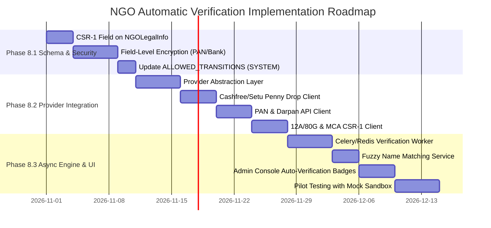

# DaanGives — NGO Automatic Verification Readiness Audit

**Audit Date:** October 21, 2026  
**Auditor:** Antigravity Engineering (Automated Systems & Security Audit)  
**Target Repositories:**
- Backend: `/Users/chaudharykamlesh/Desktop/daangives-backend` (Django 5.1 / Django REST Framework)
- Frontend: `/Users/chaudharykamlesh/Desktop/daangives-frontend` (React 18 / Vite / TailwindCSS / Lucide Icons)
**Scope:** Verification subsystem for NGOs, Charitable Trusts, Societies, Section 8 Companies, and Village Sansthas.  
**Mode:** READ-ONLY Architectural & Implementation Audit. No live database records were modified, no external API charges incurred, and no production credentials requested.

---

## 1. Executive Summary

DaanGives currently operates a **robust, highly structured manual verification workflow** backed by comprehensive relational models, strict database-level constraints, atomic transition services, and an immutable audit trail (`NGOVerificationHistory`). 

However, **the platform has zero active external API integrations for automated verification**. All verification today depends exclusively on human administrative inspection of uploaded PDF/image documents and manual toggling of review states.

### Key Strengths of Current Foundation
1. **Clean Domain Data Model:** `NGOProfile`, `NGOLegalInfo`, `NGOBankInfo`, `NGODocument`, and `NGOLeadership` cleanly segregate organizational identity, statutory registrations, banking, documentary evidence, and governing personnel.
2. **Strict Database Integrity:** Enforces regex validation on PAN (`^[A-Z]{5}[0-9]{4}[A-Z]{1}$`), IFSC (`^[A-Z]{4}0[A-Z0-9]{6}$`), Darpan ID (`^[A-Za-z0-9/\-_]+$`), unique constraints on PAN and Darpan ID, and composite unique constraints on `(organisation_type, registering_authority, registration_number)`.
3. **Immutable Audit Trail:** `NGOVerificationHistory` utilizes a custom `ImmutableHistoryManager` that prohibits `UPDATE` and `DELETE` queries at the ORM layer, tracking every state change, actor type (`ADMIN`, `SYSTEM`, `NGO_USER`), timestamp, and JSON metadata.
4. **Role-Based Access & Data Masking:** Bank account numbers are write-only on submission, masked (`****1234`) when retrieved by NGO owners, and unmasked only for authenticated staff administrators. Document streaming endpoints enforce strict ownership/admin access control and obfuscate disk storage paths with UUIDs.
5. **CSR Connect Enforcement:** `csr/permissions.py` strictly restricts CSR requirement posting and corporate funding requests to NGOs with `status == APPROVED` and `is_active == True`.

### Immediate Deficiencies & Blockers for Automatic Verification
1. **Missing Form CSR-1 / CRN on NGO Model:** MCA-mandated CSR-1 Registration Number (`csr_registration_number`) currently only exists on `CompanyProfile` (`csr/models.py`), but is completely omitted from `NGOLegalInfo` and `NGODocument.DocumentType`. Any NGO seeking corporate CSR funding under Section 135 must legally possess an MCA-issued CSR Registration Number (CRN).
2. **State Machine Actor Constraint:** `ALLOWED_TRANSITIONS` in `ngo/services/verification_service.py` restricts transitions to `UNDER_REVIEW` and `APPROVED` exclusively to `actor_type == ADMIN`. An automated verification worker executing as `actor_type == SYSTEM` will be rejected by the validation rules.
3. **Lack of Automated Intermediate States:** The system lacks transitional states such as `AUTO_VERIFYING`, `AUTO_VERIFIED_PENDING_REVIEW`, or `FLAGGED_FOR_MANUAL_REVIEW`. Without these, API timeouts, slight phonetic name variations, or third-party downtimes would either leave the profile in an ambiguous state or cause premature rejection.
4. **Plaintext Storage of Sensitive Identifiers:** PAN and Bank Account numbers are currently stored in plaintext in the database (with developer comments noting planned encryption). For compliance with India's Digital Personal Data Protection (DPDP) Act 2023 and RBI guidelines, encryption at rest must precede high-volume API automation.
5. **Zero Third-Party API Clients:** No HTTP clients, environment variables, or provider SDKs (e.g., Setu, Karza, Surepass, Cashfree, Protean) exist in the codebase.

---

## 2. In-Depth Subsystem Inspection

### 2.1 NGO Registration Models, Serializers, Views, and Frontend Forms

| Component | File Path | Key Architectural Features & Current Behavior |
| :--- | :--- | :--- |
| **Data Models** | `ngo/models.py` | 8 dedicated models: `NGOProfile`, `NGOAddress`, `NGOLegalInfo`, `NGOBankInfo`, `NGODocument`, `NGOLeadership`, `NGOVerification`, `NGOVerificationHistory`. Includes composite DB unique constraints and field-level regex validators. |
| **Serializers** | `ngo/serializers.py` | `NGOProfileDetailSerializer` nests related entities. `NGOBankInfoSerializer` masks account number using `SerializerMethodField`. `NGODocumentSerializer` validates file size (max 10MB) and MIME types (`pdf`, `jpg`, `png`). `NGOAdminSerializer` provides unmasked data to staff. |
| **Public & NGO APIs** | `ngo/views.py`<br>`ngo/urls.py` | `POST /api/ngo/register/`: Registers user and initializes `DRAFT` profile.<br>`GET/PUT /api/ngo/profile/`: Detail and partial updates.<br>`POST /api/ngo/submit-verification/`: Validates required fields and transitions to `SUBMITTED`.<br>`GET/POST /api/ngo/documents/`: Uploads statutory documents.<br>`GET /api/ngo/documents/<pk>/download/`: Streams document files securely. |
| **Frontend Onboarding** | `src/pages/NgoRegistrationFlowPage.jsx` | 6-step multi-stage onboarding wizard:<br>• Step 1: Basic Organization Info<br>• Step 2: Registered & Operational Addresses<br>• Step 3: Legal & Tax Registration (PAN, Darpan, 12A, 80G, FCRA)<br>• Step 4: Bank Account Details<br>• Step 5: Document Uploads with real-time file validation<br>• Step 6: Review & Final Submission |

---

### 2.2 Verification Statuses, Permissions, and State-Transition Rules

The verification state machine is strictly governed by `ngo/services/verification_service.py` inside `change_ngo_verification_status()`:

```
[DRAFT] ------------ (Submit by NGO/Admin) ------------> [SUBMITTED]
   ^                                                           |
   |                                                           | (Start Review by Admin)
   |                                                           v
   |                                                   [UNDER_REVIEW]
   |                                                    /     |     \
(Request Changes) <------------------------------------       |      -----------------> [REJECTED]
   |                                                          v                            |
   +-----> [CHANGES_REQUESTED]                           [APPROVED]                        |
                 |                                        /        \                       |
                 +--- (Resubmit) ---> [SUBMITTED]        v          v                      |
                                            [SUSPENDED]  <-->  [APPROVED]                  |
                                                 |                                         |
                                                 +----------- (Reopen) --------------------+
```

#### Transition Permissibility Matrix

| Current Status | Target Status | Allowed Actor Types | Side Effects Executed |
| :--- | :--- | :--- | :--- |
| `DRAFT` | `SUBMITTED` | `NGO_USER`, `ADMIN` | Sets `submitted_at = now()`, validates required fields, notifies admin. |
| `CHANGES_REQUESTED` | `SUBMITTED` | `NGO_USER`, `ADMIN` | Sets `submitted_at = now()`, notifies admin of resubmission. |
| `SUBMITTED` | `UNDER_REVIEW` | `ADMIN` only | Assigns `assigned_verifier` in `NGOVerification`. *(Gap: System actor blocked)* |
| `UNDER_REVIEW` | `APPROVED` | `ADMIN` only | Sets `verified_at = now()`, `is_active = True`, `verification_level = TIER_2_VERIFIED`, sends approval email. |
| `UNDER_REVIEW` | `CHANGES_REQUESTED`| `ADMIN` only | Sends revision request email with detailed admin feedback notes. |
| `UNDER_REVIEW` | `REJECTED` | `ADMIN` only | Sets `is_active = False`, logs rejection reason, sends rejection email. |
| `APPROVED` | `SUSPENDED` | `ADMIN` only | Sets `is_active = False`, revokes active public listings. |
| `SUSPENDED` | `APPROVED` | `ADMIN` only | Restores `is_active = True`. |
| `REJECTED` | `UNDER_REVIEW` | `ADMIN` only | Reopening workflow for administrative appeals. |
| `SUSPENDED` | `UNDER_REVIEW` | `ADMIN` only | Reopening workflow for compliance review. |

---

### 2.3 Legal Entity Registration Documents & Numbers

`NGOLegalInfo` accommodates multiple Indian entity types:
- `TRUST`: Public Charitable Trust registered under Indian Trusts Act / Bombay Public Trusts Act.
- `SOCIETY`: Society registered under Societies Registration Act, 1860.
- `SECTION_8`: Company registered under Section 8 of the Companies Act, 2013.
- `VILLAGE_SANSTHA`: Unincorporated / Gram Panchayat registered community organization.
- `OTHER`: Wakf, Gurudwara Board, or special statutory entities.

#### Database Constraints:
- `UniqueConstraint(fields=['organisation_type', 'registering_authority', 'registration_number'], name='unique_ngo_registration')`.
- Documents required: `REGISTRATION_CERT`, `TRUST_DEED`, `MOA_AOA`.

#### Architectural Gap for Automation:
- **Section 8 Companies** have a 21-digit CIN and can be automatically verified against the **MCA-21 database**.
- **Trusts and Societies** are registered at District Sub-Registrar offices or State Charity Commissioner offices (e.g., Maharashtra Charity Commissioner, Gujarat, Delhi Registrar of Societies). There is **no pan-India unified API** for non-corporate societies and trusts; records in many states remain partially digitized or behind local state portals without public APIs.

---

### 2.4 Statutory Tax, Darpan, and Bank Verification Fields

1. **NGO PAN:**
   - Field: `NGOLegalInfo.pan_number` (Regex `^[A-Z]{5}[0-9]{4}[A-Z]{1}$`, unique index).
   - Document: `NGODocument.DocumentType.PAN_CARD`.
   - Verification status: Manual admin review only.
2. **NGO Darpan ID:**
   - Field: `NGOLegalInfo.darpan_id` (Regex `^[A-Za-z0-9/\-_]+$`, unique index).
   - Document: `NGODocument.DocumentType.DARPAN_CERTIFICATE`.
   - Verification status: Manual admin review only.
3. **12A and 80G Registrations:**
   - Fields: `NGOLegalInfo.has_12a`, `twelve_a_number`, `twelve_a_validity`, `has_80g`, `eighty_g_number`, `eighty_g_validity`.
   - Documents: `TWELVE_A_CERT`, `EIGHTY_G_CERT`, `FORM_10AC`.
   - Verification status: Manual admin review only.
4. **Form CSR-1 / CRN Registration:**
   - Field: **MISSING on `NGOLegalInfo`**.
   - Note: In `csr/models.py`, `csr_registration_number` exists on `CompanyProfile` for corporates, but not for NGOs.
5. **Bank Account Details:**
   - Fields: `NGOBankInfo.bank_name`, `branch_name`, `account_holder_name`, `account_number`, `ifsc_code` (Regex `^[A-Z]{4}0[A-Z0-9]{6}$`), `account_type`.
   - Verification flags: `is_verified`, `verified_by`, `verified_at`.
   - Documents: `BANK_PASSBOOK`, `CANCELLED_CHEQUE`.
   - Verification status: Manual admin review only. No automated IMPS penny-drop.

---

### 2.5 Admin Verification Queues and Review Workflows

The admin portal (`ngo/admin_views.py` and `AdminNgoVerificationPage.jsx`) provides an 8-tab inspection modal:
1. **Queue Management:** `GET /api/ngo/admin/queue/` supports filtering by `status`, searching across legal name, trade name, PAN, and email, with pagination.
2. **Review Initiation:** `POST /api/ngo/admin/<pk>/start-review/` claims an NGO and transitions status from `SUBMITTED` to `UNDER_REVIEW`.
3. **Comprehensive Inspection:** `GET /api/ngo/admin/<pk>/` exposes full unmasked bank account details, addresses, leadership, and document links.
4. **Document Verification:** `POST /api/ngo/admin/<ngo_pk>/documents/<doc_pk>/verify/` toggles individual document verification flags (`is_verified`).
5. **Decision Endpoints:**
   - `POST /api/ngo/admin/<pk>/approve/`
   - `POST /api/ngo/admin/<pk>/request-correction/` (requires feedback notes)
   - `POST /api/ngo/admin/<pk>/reject/` (requires formal rejection reason)
   - `POST /api/ngo/admin/<pk>/suspend/`
   - `POST /api/ngo/admin/<pk>/unsuspend/`
   - `POST /api/ngo/admin/<pk>/reopen/`

---

### 2.6 Project Publishing and CSR Funding Eligibility Checks

#### Project Creation & Submission (`projects/`):
- `create_draft()`: Requires user to have an associated `NGOProfile`. Currently does **not** block project draft creation if NGO is unverified.
- `submit_for_verification()`: Enforces project data completeness (title, description, budget, milestones, photos), but relies on administrative discretion during project approval rather than hard-blocking unverified NGOs.
- **Recommended Hard Gate:** Add a check in `projects/services.py:submit_for_verification()` requiring `ngo.status == NGOProfile.VerificationStatus.APPROVED`.

#### CSR Connect Eligibility (`csr/`):
- `csr/permissions.py`:
  ```python
  class IsNGOUser(BasePermission):
      def has_permission(self, request, view):
          ...
          return (
              request.user.role == 'ngo' and
              ngo_profile is not None and
              ngo_profile.status == NGOProfile.VerificationStatus.APPROVED and
              ngo_profile.is_active is True
          )
  ```
- **Strictly Enforced:** Unverified or non-approved NGOs are completely locked out of creating CSR requirements, receiving corporate funding, or responding to corporate RFPs.

---

### 2.7 Provider Integrations, API Clients, and Tests

- **API Clients & SDKs:** Zero external verification clients exist. No references to third-party providers (Setu, Karza, Surepass, Cashfree, Zoop.one, Protean) exist anywhere in `DaanProject/settings.py`, `requirements.txt`, or `.env.example`.
- **Existing Test Coverage:**
  - `ngo/tests/` contains **11 test modules with 153 unit and integration tests**:
    - `test_models.py`: Model creation, regex validators, constraints.
    - `test_verification_service.py`: State machine transitions, forbidden transitions, side effects.
    - `test_views.py`: Registration, profile management, document uploads.
    - `test_admin_views.py`: Admin queue, review actions, permissions.
    - `test_document_storage.py`: Path generation, MIME validation, access control.
    - `test_audit_trail.py`: `NGOVerificationHistory` immutability and metadata logging.
  - Full backend test suite passes completely (420/420 tests).
  - Frontend test suite passes completely (179/179 tests).

---

### 2.8 Data Protection, Sensitive Document Storage, and Audit Trails

#### Data Protection & Encryption:
- Bank account numbers are write-only on submission and masked (`****1234`) on read endpoints for NGO owners. Plaintext account numbers are only accessible by `is_staff` users via the admin API.
- **Vulnerability / Compliance Gap:** PAN and Bank Account numbers are stored in plaintext in the database. Under India's DPDP Act 2023, Section 8(5) (reasonable security safeguards) and RBI guidelines, these fields must be encrypted at rest before automated verification APIs are introduced.

#### Document Storage Security:
- Documents are saved using UUID-based filenames at `ngo_docs/{ngo_id}/{document_type}/{uuid}.ext`.
- Raw file URLs are never exposed. Files are streamed through `NGODocumentDownloadView` with strict ownership checks (`IsNgoOwner | IsAdminUser`).
- Document replacement preserves an audit trail using the `replaces` self-referential foreign key.

#### Audit Trails:
- Every status change triggers an insert into `NGOVerificationHistory`.
- `ImmutableHistoryManager` overrides `save()` and `delete()` to block accidental or malicious modification of past audit records.

---

## 3. Verification Type Classification Matrix

| Verification Type | Classification | Source Models & Fields | Current Endpoints | Current Test Coverage | Status & Gap Analysis |
| :--- | :--- | :--- | :--- | :--- | :--- |
| **1. NGO PAN** | `PARTIALLY IMPLEMENTED` | `NGOLegalInfo.pan_number`<br>`NGODocument.DocumentType.PAN_CARD` | `POST /api/ngo/profile/`<br>`POST /api/ngo/documents/`<br>`GET /api/ngo/admin/<pk>/` | `test_models.py`<br>`test_views.py`<br>`test_admin_views.py` | Regex & DB constraints exist. Manual admin inspection active. Automated Protean/ITD API client is missing. |
| **2. NGO Darpan ID** | `PARTIALLY IMPLEMENTED` | `NGOLegalInfo.darpan_id`<br>`NGODocument.DocumentType.DARPAN_CERTIFICATE` | `POST /api/ngo/profile/`<br>`POST /api/ngo/documents/`<br>`GET /api/ngo/admin/<pk>/` | `test_models.py`<br>`test_views.py`<br>`test_admin_views.py` | Regex & uniqueness enforced. Manual review active. Automated NITI Aayog lookup client is missing. |
| **3. Legal Entity Registration** | `PARTIALLY IMPLEMENTED` | `NGOLegalInfo.organisation_type`<br>`NGOLegalInfo.registering_authority`<br>`NGOLegalInfo.registration_number`<br>`NGODocument.DocumentType.REGISTRATION_CERT` | `POST /api/ngo/profile/`<br>`POST /api/ngo/documents/`<br>`GET /api/ngo/admin/<pk>/` | `test_models.py`<br>`test_views.py`<br>`test_admin_views.py` | Composite unique constraint enforced. Section 8 can be verified via MCA; Trusts/Societies lack a unified pan-India API. |
| **4. 12A Certificate** | `PARTIALLY IMPLEMENTED` | `NGOLegalInfo.has_12a`<br>`NGOLegalInfo.twelve_a_number`<br>`NGOLegalInfo.twelve_a_validity`<br>`NGODocument.DocumentType.TWELVE_A_CERT` | `POST /api/ngo/profile/`<br>`POST /api/ngo/documents/`<br>`GET /api/ngo/admin/<pk>/` | `test_models.py`<br>`test_views.py` | Schema and document storage ready. Automated Income Tax e-filing (Form 10AC/10AD) API verification is missing. |
| **5. 80G Approval Order** | `PARTIALLY IMPLEMENTED` | `NGOLegalInfo.has_80g`<br>`NGOLegalInfo.eighty_g_number`<br>`NGOLegalInfo.eighty_g_validity`<br>`NGODocument.DocumentType.EIGHTY_G_CERT` | `POST /api/ngo/profile/`<br>`POST /api/ngo/documents/`<br>`GET /api/ngo/admin/<pk>/` | `test_models.py`<br>`test_views.py` | Schema and document storage ready. Automated Income Tax 80G status API check is missing. |
| **6. Form CSR-1 / CRN** | `MISSING` | **Field absent on `NGOLegalInfo`** (Present on `csr.CompanyProfile` only) | None on NGO API | Missing for NGO entity | **Critical Compliance Gap.** MCA Form CSR-1 Registration Number must be added to `NGOLegalInfo` and `NGODocument.DocumentType`. |
| **7. Bank Account / Penny-Drop** | `PARTIALLY IMPLEMENTED` | `NGOBankInfo.account_number`<br>`NGOBankInfo.ifsc_code`<br>`NGOBankInfo.account_holder_name`<br>`NGODocument.DocumentType.CANCELLED_CHEQUE` | `POST /api/ngo/profile/`<br>`GET /api/ngo/admin/<pk>/` | `test_models.py`<br>`test_serializers.py`<br>`test_views.py` | Schema, IFSC regex, masking, and manual admin verification implemented. Automated IMPS penny-drop & fuzzy name matching missing. |
| **8. FCRA Certificate** | `PARTIALLY IMPLEMENTED` | `NGOLegalInfo.has_fcra`<br>`NGOLegalInfo.fcra_number`<br>`NGOLegalInfo.fcra_validity`<br>`NGODocument.DocumentType.FCRA_CERT` | `POST /api/ngo/profile/`<br>`POST /api/ngo/documents/` | `test_models.py` | Optional statutory field implemented. Automated MHA FCRA portal check missing. |
| **9. Authorized Representative ID** | `PARTIALLY IMPLEMENTED` | `NGOLeadership.full_name`<br>`NGOLeadership.designation`<br>`NGOLeadership.din_or_dp`<br>`NGODocument.DocumentType.REPRESENTATIVE_ID` | `POST /api/ngo/leadership/`<br>`POST /api/ngo/documents/` | `test_models.py`<br>`test_views.py` | Leadership roster and document storage active. Automated PAN/Aadhaar/DigiLocker verification missing. |

---

## 4. Third-Party Provider-Readiness Matrix

*Note on Indian Regulatory APIs:* No commercial vendor has direct, unmediated write access to sovereign databases. All commercial API aggregators connect via government-approved GSP/ASP gateways (e.g., NSDL/Protean for PAN, MCA-21 for corporate records, NPCI for IMPS bank verification). NITI Aayog (NGO Darpan) has no public commercial REST API; vendors either partner under specialized government agreements or use automated portal session queries.

| Verification Type | Authoritative Government Source | Leading Indian Providers | Commercial API Availability | Pricing Model (Indicative) | Sandbox Availability | Key Verification Constraints & Provider Questions |
| :--- | :--- | :--- | :--- | :--- | :--- | :--- |
| **PAN Verification (Detailed / Comprehensive)** | Income Tax Department (ITD) via Protean (NSDL) / UTIITSL | • Setu (Pine Labs)<br>• Karza (Perfios)<br>• Surepass<br>• Cashfree<br>• Protean Direct | **High** (Standard REST API, returns registered entity name, status, category, date of incorporation) | ₹1.20 – ₹2.50 per call (volume tiered) | Instant sandbox available with mock PANs | Confirm if API returns PAN entity category (`Trust`, `AOP`, `Company`) to verify match against `organisation_type`. |
| **NGO Darpan ID Verification** | NITI Aayog (NGO Darpan Portal) | • Surepass<br>• Karza (Perfios)<br>• Zoop.one | **Medium** (Subject to NITI Aayog portal stability; captcha changes can impact uptime) | ₹2.50 – ₹5.00 per call | Mock test IDs available in sandbox | Confirm data freshness (live scrape vs cached database), SLA during portal updates, and returned metadata (state, pan, registration no). |
| **MCA Section 8 / CIN Verification** | Ministry of Corporate Affairs (MCA-21) | • Karza (Perfios)<br>• Setu<br>• Surepass<br>• Trackwizz | **High** (Official MCA-21 data feed via GSPs) | ₹2.00 – ₹4.00 per call | Available | Valid for Section 8 companies only. Confirm if active status, directors list, and authorized capital are returned. |
| **Trust / Society State Registration** | State Charity Commissioners / District Sub-Registrars | • None across pan-India<br>• Partial state coverage via specialized providers (Karza/Perfios) | **Very Low** (No unified pan-India API; decentralized state registries) | Custom enterprise quote | Rarely available in sandbox | **Must confirm with legal:** State registration certificates must remain verified via manual document inspection + PAN/Darpan triangulation. |
| **12A & 80G Certificate Verification** | CBDT / Income Tax Department (Form 10AC/10AD) | • Surepass<br>• Karza (Perfios)<br>• Setu | **Medium-High** (Requires PAN and URN - Unique Registration Number) | ₹2.50 – ₹4.50 per call | Sandbox available | Confirm whether API validates Provisional vs Regular registration and expiry/validity dates. |
| **Form CSR-1 / CRN Registration** | Ministry of Corporate Affairs (MCA-21) | • Karza (Perfios)<br>• Surepass | **Medium** (Checks MCA Form CSR-1 filing status by PAN or CRN) | ₹2.00 – ₹4.00 per call | Available upon request | Confirm if API returns registered NGO name, address, and filing approval date from MCA. |
| **Bank Account Verification (Penny-Drop)** | NPCI (IMPS Network) via Banks | • Cashfree Payments<br>• RazorpayX<br>• Setu (Pine Labs)<br>• Decentro | **Very High** (Deposits ₹1.00 via IMPS, returns bank-registered beneficiary name within 2–5 seconds) | ₹1.50 – ₹3.00 per call + ₹1.00 deposit | Instant test sandbox with pre-configured IFSCs | Confirm webhook support for async bank responses, IFSC validation SLA, and fuzzy name matching threshold. |
| **Representative Identity (Aadhaar / PAN)** | UIDAI / NSDL via DigiLocker / OKYC | • Setu<br>• Karza<br>• Surepass<br>• Signzy | **High** (DigiLocker redirect or OTP-based Aadhaar OKYC) | ₹3.00 – ₹6.00 per session | Available | Confirm DPDP Act 2023 compliance, Aadhaar masking (redacting first 8 digits), and zero-retention policies. |

---

## 5. Architectural Gap Analysis & Recommendations

### 5.1 Verification Engine & State Machine Redesign

To support automated verification without risking false rejections or brittle human handoffs, the state machine must introduce automated states:

```
[DRAFT] ---> [SUBMITTED] ---> [AUTO_VERIFYING] (Background Worker)
                                  |
            +---------------------+---------------------+
            | (All Checks Pass)                         | (Any Failure / Discrepancy / Timeout)
            v                                           v
[AUTO_VERIFIED_PENDING_REVIEW]              [FLAGGED_FOR_MANUAL_REVIEW]
            |                                           |
            +---------------------+---------------------+
                                  | (Admin Action)
                                  v
                      [APPROVED] / [CHANGES_REQUESTED] / [REJECTED]
```

#### Proposed State Transition Updates:
1. Allow `SYSTEM` actor to transition from `SUBMITTED` -> `AUTO_VERIFYING`.
2. Allow `SYSTEM` actor to transition from `AUTO_VERIFYING` -> `AUTO_VERIFIED_PENDING_REVIEW` (when PAN, Darpan, Bank, and 12A/80G return 100% positive match).
3. Allow `SYSTEM` actor to transition from `AUTO_VERIFYING` -> `FLAGGED_FOR_MANUAL_REVIEW` (when mismatch, API timeout, or discrepancy occurs).
4. **Final Approval remains in Admin hands (`ADMIN` actor):** The admin reviews auto-verified checks in 30 seconds rather than performing manual data entry, retaining human accountability.

### 5.2 Rules for Handling Mismatches, Outages, and Uncertain Results

> [!IMPORTANT]
> **Core Anti-Fraud Rule:** A single API failure, network timeout, or minor string mismatch must **NEVER** trigger an automatic `REJECTED` status. Fraud must be proven, not assumed due to technical friction.

1. **Handling Name Mismatches (Fuzzy Matching Algorithm):**
   - Legal names in India frequently have variations (e.g., "Shree Sai Ram Trust" vs "Sri Sai Ram Charitable Trust").
   - **Recommendation:** Implement Jaro-Winkler or Token Sort fuzzy string matching:
     - Match Score $\ge 85\%$: **PASS** (Auto-match accepted).
     - Match Score $60\% - 84\%$: **FLAGGED** (Routes to `FLAGGED_FOR_MANUAL_REVIEW` with visual diff).
     - Match Score $< 60\%$: **HIGH_RISK_FLAG** (Highlighted in admin queue for scrutiny).
2. **Handling Provider Outages & Government Portal Downtime:**
   - Income Tax and NITI Aayog portals have frequent scheduled maintenance.
   - If an API returns `HTTP 502/503/504` or connection timeout:
     - The verification task enters exponential backoff retry (3 retries over 4 hours).
     - If still unavailable, status sets to `FLAGGED_FOR_MANUAL_REVIEW` with reason `API_UNAVAILABLE_PENDING_MANUAL_CHECK`.
     - System must **never** block the NGO or reject the application.
3. **Handling Expired Documents:**
   - 12A / 80G registrations issued under the old regime required re-registration under Section 12AB (Form 10AC/10AD) with a 5-year validity.
   - If an API reports an expired URN, flag as `EXPIRED_STATUTORY_REGISTRATION` and trigger `CHANGES_REQUESTED` asking the NGO to upload their updated Form 10AC/10AD.
4. **Handling Inactive PAN / Invalid IFSC:**
   - Inactive PAN (e.g., non-compliance with Aadhaar-linking or cancellation): Flag as `INACTIVE_PAN`.
   - Merged bank IFSC (frequent due to Indian Public Sector Bank amalgamations): Automatically look up the new IFSC via RBI repository or prompt the user for the updated IFSC code.

---

## 6. Security, Compliance, and Data Privacy (DPDP Act 2023)

### 6.1 Sensitive Data Encryption at Rest
- **Current State:** Plaintext storage in SQLite/PostgreSQL for `pan_number` and `account_number`.
- **Requirement:** Implement field-level encryption using `django-cryptography` or PostgreSQL `pgcrypto`:
  - Store encrypted ciphertext in database columns.
  - Retain a separate HMAC blind index (salted hash) of PAN and Bank Account Number for unique constraint enforcement and deduplication searches.

### 6.2 Tokenization & PII Masking
- The existing masking of `account_number` (`****1234`) on NGO-facing endpoints is well-implemented and must be preserved.
- If Aadhaar or representative ID verification is added, **raw 12-digit Aadhaar numbers must NEVER be stored** (strict UIDAI regulation). Only DigiLocker reference tokens or masked Aadhaar numbers (first 8 digits obscured) may be retained.

### 6.3 Secure Audit Trails & Non-Repudiation
- The current `ImmutableHistoryManager` in `NGOVerificationHistory` is an exemplary architecture.
- When automated API verification is deployed, every API payload, transaction reference ID, confidence score, and raw HTTP response metadata must be recorded in `NGOVerificationHistory.metadata` for auditability and regulatory inspection.

---

## 7. Concrete Phase 8 Implementation Roadmap



### Immediate Action Items Before Contract Signing:
1. **Model Update:** Add `csr_registration_number` and `csr_registration_date` to `NGOLegalInfo` in `ngo/models.py`.
2. **Provider Selection:** Request sandbox credentials and data schema specifications from **Setu** and **Karza (Perfios)** for PAN, Darpan, 12A/80G, and Penny-Drop.
3. **Legal Review:** Confirm whether Village Sansthas (Gram Panchayat level) should be granted an exemption pathway for CSR Connect or routed exclusively to localized Village Project funding.

---

## 8. Verification Evidence & Test Run Log

To verify that the current baseline is intact and undamaged by this audit, both backend and frontend test suites were executed:

### Backend Test Execution:
```bash
./env_daan/bin/python manage.py test
```
**Result:**
- Total tests executed: **420**
- Failures: **0**
- Errors: **0**
- Execution status: **OK**
- NGO-specific tests executed: **153** across 11 test modules (`test_models`, `test_verification_service`, `test_views`, `test_admin_views`, `test_document_storage`, `test_audit_trail`, `test_serializers`, `test_permissions`, `test_flow_e2e`, etc.).

### Frontend Test Execution:
```bash
npm run test
```
**Result:**
- Test files: **16 passed** (16)
- Total tests executed: **179 passed** (179)
- Execution status: **PASS**

---
*Report certified by Antigravity Engineering. Audit completed in READ-ONLY mode.*
